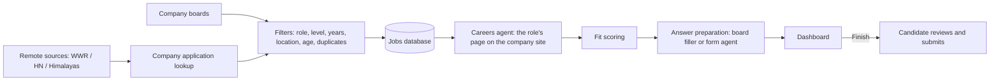

# Job Agent


Job Agent is a privacy-conscious job search assistant. It finds AI and agent engineering roles that are US-remote or in North Carolina, and scores each one against a private candidate profile. It prepares a grounded answer for every application question and fills in the forms. The candidate reviews every application and submits it.

## What I Built

A summary of the project, from build to debugging to measurement. Figures come from the
repository and from my local job database.

### Impact

- **Applied to 28 jobs at 26 companies** (Oct 3 to Oct 16, 2026), counted from the jobs
  marked applied in my local database.
- **Saved about 30 minutes per application** by generating a tailored one-page resume and an
  answer to every application question for each job. That is about 14 hours across the 28
  applications.
- **Saved at least 1 hour a day of job searching.** A scheduled morning run finds, filters,
  and scores new roles that match my location, role type, and experience level, so they are
  waiting in the dashboard by 9am Eastern.

### Build

- **Built a job search agent in Python (about 15,000 lines)** that discovers AI and agent
  engineering roles from 8 sources: the Greenhouse, Lever, Ashby, and SmartRecruiters job
  board APIs, We Work Remotely (RSS), Hacker News "Who is hiring?", the Himalayas job API,
  and the public SimplifyJobs new-grad list.
- **Wrote deterministic filters** for title, seniority, required years of experience (2 or
  fewer), location (US-remote or North Carolina), posting age, duplicates, and at most three
  roles per company, so the model only sees jobs that pass hard rules.
- **Built six model-driven components on the Anthropic Claude API** (Sonnet 5.5 and Opus
  5.5): a fit scorer, a careers agent, a form agent, a library agent, a resume sub-agent,
  and an answers sub-agent. They use tool use, structured outputs validated with Pydantic,
  the web search tool, and a fallback model on refusals.
- **Built an orchestrator agent** (`job-run --agent --goal N`) that runs a tool-use loop over
  the pipeline's modules (find jobs, check company pages, score, read a form, build a kit)
  and picks each next step toward a goal of N ready kits. It remembers which jobs I applied
  to or removed. Filters and budgets stay in code, and it has no submit tool.
- **Built a resume sub-agent** that rebuilds a one-page Word resume (python-docx) for each
  posting from a master CV, using the posting's exact keywords. It maps every required and
  preferred qualification, copied word for word, to the bullet that covers it. It searches
  my public GitHub repositories (READMEs and dependency files) for skill evidence before it
  calls a skill missing, and treats "X or Y" requirements as one requirement.
- **Automated browser form filling with Playwright** for Greenhouse, Lever, Ashby, and
  SmartRecruiters, plus an agent for unfamiliar forms (Workday, iCIMS, Zoho, custom sites)
  that reads controls inside iframes and works through multi-page applications.
- **Built a local dashboard** on the standard-library HTTP server (HTML, CSS, JavaScript)
  that lists each job with its fit score and posting age. Its Apply sidebar shows every
  answer with Copy buttons and the tailored resume to download.
- **Stored jobs and applications with SQLAlchemy 2** on SQLite (or PostgreSQL 16 in Docker
  Compose), with 8 Alembic schema migrations.
- **Scheduled a daily run** with Windows Task Scheduler (cron on macOS and Linux) that
  prepares kits for new matches before 9am Eastern.
- **Kept personal data out of a public repository** with a custom Git pre-commit hook that
  blocks private files and any line containing values from my local profile.

### Debugging

- **Checked model claims in code.** The careers agent once reported a role from a search
  result it never opened, and once reported a list of openings as the role. Code now
  requires the job title to appear on a page the agent opened.
- **Fixed a race in multi-threaded fit scoring.** One job in three failed because worker
  threads shared a database session. Reading job fields before the threads start fixed it.
- **Fixed the form agent missing questions** on later pages, inside iframes, and past a
  control limit. It now records every question it sees, and it is sent back if it tries to
  finish while a Next button remains.
- **Diagnosed why no new jobs were showing up.** My local copy was 57 commits behind `main`,
  so the newer filters and the morning run had never reached it. I tested the current
  filters against all 195 saved jobs to confirm the code on `main` worked.
- **Shipped 13 bug-fix commits** alongside 24 feature commits and 15 merged pull requests,
  adding tests for the fixed behavior as I went.

### Measurement and Evaluation

- **Wrote a 534-test pytest suite** that runs fully offline: HTTP calls, the Anthropic SDK,
  and the database are mocked, and form tests drive a real headless Chromium against local
  HTML forms, including multi-page forms and iframes.
- **Ran CI on GitHub Actions** on every push and pull request: Ruff linting, then pytest
  with the Playwright browser installed.
- **Logged each orchestrator run** to a JSONL file with every step, its time, and token use
  (input, output, and prompt-cache reads and writes), to measure cost and speed per kit.
- **Verified model output in code instead of trusting it.** Every resume bullet and written
  answer must quote its source, and code checks each quote. Code rejects any tool or number
  the sources don't support.
- **Scored fit with a 0 to 100 rubric** and a threshold of 70, using structured outputs so
  each score is machine-checked.

### Technical Challenge: the blank browser window

Pressing **Fill with agent** on the dashboard opened a Chrome window showing only
`about:blank`, and the agent never filled anything. The console window closed as soon as
the program ended, so there was no error to read.

I worked through it in rounds, one cause at a time
([specs/005](specs/005-fill-with-agent-blank-window.md)):

1. **Made the error visible.** Errors now stay on screen until Enter is pressed, and the
   window shows which page it is opening right away.
2. **Found the main cause:** Chrome allows one browser per profile. When an earlier agent
   window was still open, the new launch handed its blank tab to the old window and exited.
   The dashboard now checks whether the profile is in use and says to close the old window
   first. I tested the lock with full Chromium, the same browser the hand-off uses.
3. **The window then opened behind the dashboard.** Windows does not let a background
   program bring its window to the front, so the agent minimizes and restores its window
   and moves it onto the main screen.
4. **The form then could not scroll to the bottom.** Playwright draws every page at a fixed
   1280x720, so a smaller window cut off the form. Opening the browser with
   `no_viewport=True` lets the page fit the window.

What I learned: when a failure leaves no trace, make it leave one first, then fix one
cause at a time and test each fix in the real environment.

### What I Learned

- **Agent design:** when to use a fixed pipeline and when to let a model pick the next step,
  and how to keep hard rules, budgets, and the final submit decision in code.
- **The Anthropic Claude API:** tool use loops, structured outputs, the server-side web
  search tool, token accounting, refusal handling with a fallback model, and choosing
  Sonnet or Opus for each task.
- **Grounding and verification:** making a model quote its sources and checking those
  quotes in code, so it cannot invent facts on a resume.
- **Browser automation with Playwright:** iframes, multi-page forms, browser profiles and
  their locks, viewports, and window focus on Windows.
- **Data and backend:** SQLAlchemy 2, Alembic migrations, SQLite and PostgreSQL, and
  thread safety with database sessions.
- **Testing and CI:** offline tests with mocked APIs, headless browser tests, and GitHub
  Actions.
- **Working with an AI coding agent:** building with Claude Code through specs, small pull
  requests, and code review, with a roadmap and a written review checklist.
- **Privacy engineering:** keeping personal data out of a public repository with
  git-ignored paths and a pre-commit hook.

## Highlights

- **Discovery across many sources.** It reads Greenhouse, Lever, Ashby, and SmartRecruiters boards through their public APIs, plus We Work Remotely, Hacker News "Who is hiring?", and Himalayas. Companies are also found automatically from the SimplifyJobs list. Rule-based filters keep only roles that match on title, seniority, years required (roles open to recent graduates or needing at most 2 years), location, and posting age, duplicates are removed, and only the top three matches per company are kept (`max_jobs_per_company`). Jobs already found are checked again on every run, after the company's own page fills in the full description.
- **Three Claude agents, each checked in code:**
  - The **careers agent** finds a third-party job on the company's own site and links to that role's page or application form. It never links to the general careers page. The title must appear on a page the agent actually opened.
  - The **form agent** fills unfamiliar forms such as Workday, iCIMS, Zoho Recruit, and custom career sites. It reads controls inside iframes and works through multi-page forms. It records every question it sees, and anything it can't answer is listed for the candidate. Code refuses any click that would submit the application.
  - The **library agent** drafts written answers from a private folder of essays and project write-ups. Every sentence must carry a quote from a named document, and code verifies each quote.
- **Grounded answers.** Structured outputs validated with Pydantic are used for fit scoring and for answers. Factual answers must be exact phrases from the profile or resume. Written drafts cite evidence for every sentence and are never submitted without the candidate's review.
- **The candidate submits.** Every run is a dry run unless stated otherwise. A dry run saves a screenshot and an HTML review page. Hand-off mode fills the form in Chrome and leaves the window open for the candidate. Assist mode lets the candidate copy answers into their own browser. Live mode is opt-in and guarded by fit re-checks, daily and per-company caps, and fail-closed handling of unconfirmed submissions.
- **An apply kit for each job, from two sub-agents.** The **resume sub-agent** rebuilds the resume from a long private experience bank around the job description's exact keywords (its action verbs and tech stack), showing how each tool was used in each project. Every bullet must quote its sources, and code rejects any tool or number the sources don't support; before calling a keyword missing it also searches the candidate's public GitHub repositories (READMEs and the libraries each one uses), and when the posting accepts either of two skills ("LangGraph or LangChain") one found is enough. It asks nothing: a keyword with no evidence anywhere is left off the resume and listed as a gap in the keyword report, with a suggested bullet on the entry where it fits best (`job-kit --ask` asks about each one instead). Each kit also has a **qualification map**: every required and preferred qualification and every duty, copied word for word from the posting, with the resume bullet that hits it and the quote it was written from, shown in the Apply sidebar and saved as `qualifications.md`. Its content comes from a master CV of every activity, and its look (font, text size, section headings in order) is copied from the candidate's own one-page resume, the format example; without one it is Times New Roman with Education, Experience, Technical Projects, and Skills. The output is a one-page Word document, 10 pt or larger; terms from the required and preferred qualifications are covered first, and the lowest-value bullets are trimmed until it fits one page. A resume holds at most four jobs and three projects (GitHub repositories count as projects), the most relevant ones, each with at least two bullets and usually three or four; a draft that leaves much of the page empty is sent back once for more, and trimming drops a whole weak entry rather than leave one with a single bullet. Your current job (dates ending in "Present") is on every resume, and so are the entries and bullets listed under `resume.always_include` in `profile/profile.yaml`. The **answers sub-agent** answers every question on the form, plus why this company, why this role, and a technical project, specific to the company and role and written in the candidate's voice from their writing samples.
- **Local dashboard.** It shows every job with its fit score, posting age, and prepared answers. Clicking **Apply** opens the role on the company's site in a new tab and opens a sidebar with every answer (with Copy buttons) and the tailored resume to download. Buttons let the candidate prepare the kit, mark a job applied, undo, remove it, or start the form agent on the job's real form.
- **Privacy by design.** Personal data never enters Git. A custom pre-commit hook blocks private files and any line containing identifying values from the local profile.

## Tech Stack

| Area | Technology |
| --- | --- |
| Language | Python 3.11+ (developed on 3.12), JavaScript for the in-page form snapshot |
| LLM | Anthropic Claude API: Sonnet 5.5 for scoring, answers, and the careers agent; Opus 5.5 for the form agent. Uses tool use, structured outputs, web search, and refusal fallback |
| Browser automation | Playwright (Chromium and installed Chrome) |
| Data | SQLAlchemy 2 with SQLite (default) or PostgreSQL 16; Alembic migrations; Pydantic v2 |
| HTTP and documents | httpx, pypdf, python-docx (tailored resumes), PyYAML, python-dotenv |
| Web UI | Standard-library `http.server`, HTML, CSS, JavaScript |
| Quality | pytest (offline: mocked HTTP and SDK, real headless browser), Ruff, GitHub Actions CI |
| Infrastructure | Docker Compose (optional Postgres), Git pre-commit hook, Windows Task Scheduler or cron for the morning run |
| Job sources | Greenhouse, Lever, Ashby, and SmartRecruiters board APIs; We Work Remotely RSS; Hacker News "Who is hiring?"; Himalayas API; SimplifyJobs new-grad list; GitHub REST API for skill evidence |
| Development tools | Claude Code (AI coding agent for specs, pull requests, and fixes), Git and GitHub pull requests, Notion for task tracking, PowerShell on Windows |

Dependency ranges are in [pyproject.toml](pyproject.toml). The tested versions are anthropic 0.125, playwright 1.63, SQLAlchemy 2.1, alembic 1.20, pydantic 2.13, httpx 0.28, pytest 8.4, and ruff 0.16.

## Architecture



```text
agent/
  main.py, pipeline.py      discovery and the job-run pipeline
  orchestrator.py           job-run --agent: picks each next step toward a goal of N kits
  filters.py, seniority.py  deterministic scope and duplicate rules
  scorer.py, answers.py     Claude fit scoring and grounded answers
  careers_agent.py          finds the role on the company's own site
  form_agent.py (+ .js)     agent for unfamiliar forms
  library_agent.py          cited drafts from the private source library
  apply_kit.py              job-kit: runs the resume and answers sub-agents for one job
  resume_tailor.py          resume sub-agent: exact-keyword resume, every bullet sourced
  resume_format.py          master CV and format example: what the resume picks from, how it looks
  answer_agent.py           answers sub-agent: every question for one job
  dashboard.py              local dashboard server
  fetchers/, sources/       job board APIs and remote sources
  applier/                  board form fillers, review pages, hand-off/assist/live CLI
db/                         SQLAlchemy models and Alembic migrations
scripts/                    privacy pre-commit hook
tests/                      offline test suite
```

## Quick Start

```powershell
py -3.12 -m venv .venv312; .\.venv312\Scripts\Activate.ps1
python -m pip install -e ".[dev]"
python -m playwright install chromium
copy .env.example .env               # add ANTHROPIC_API_KEY and RESUME_PATH
python scripts/install_hooks.py      # privacy guard
job-run                              # discover, score, prepare, open the dashboard
job-run --agent --goal 5             # let the agent pick each step until 5 kits are ready
job-daily --install                  # prepare new jobs every morning before 9am Eastern
```

`job-daily --install` registers a morning run with Windows Task Scheduler (or cron on macOS and Linux). It finds and scores new jobs, then builds a tailored resume and every answer for each good match, so they are waiting in the dashboard by `daily_run.ready_by` in [config/settings.yaml](config/settings.yaml). The log is in `data/daily-run.log`.

`job-run --agent --goal N` hands the run to one orchestrator agent. It sees the current counts, what you applied to and removed, and its last few runs, then picks its own next step (score, find new jobs, read a form, build a kit) until N kits are ready with no problems. The filters, the candidate list, and every budget stay in code, and it has no way to submit. Each run's steps, times, and token use are appended to `data/agent-runs.jsonl` (git-ignored). See [specs/009-orchestrator-agent.md](specs/009-orchestrator-agent.md).

Put your private profile in `profile/profile.yaml` (see the fictional [profile.example.yaml](profile/profile.example.yaml)). Put your master CV (every job, project, and activity) at `profile/master_cv.pdf`, or set `MASTER_CV_PATH` in `.env`; the resume at `RESUME_PATH` is the format example, or set `RESUME_FORMAT_PATH`. Put your long list of jobs, projects, and activities (any Markdown, text, PDF, or Word files) in `profile/library/`, and samples of your own writing in `profile/writing_samples/`. All three are git-ignored and blocked by the privacy hook. The scope, models, and caps are set in [config/settings.yaml](config/settings.yaml).

| Command | What it does |
| --- | --- |
| `job-run` | Full pipeline: discovery, fit scoring, company page lookup, answer preparation, dashboard; `--agent --goal N` lets the orchestrator agent pick the steps |
| `job-agent` | Discovery only |
| `job-apply` | Fill a Greenhouse, Lever, Ashby, or SmartRecruiters form (dry run; `--hand-off`, `--assist`, `--live`) |
| `job-agent-fill` | Run the form agent on any other application form |
| `job-company-pages` | Find third-party jobs on the company's own site |
| `job-daily` | Morning run: find, score, and build kits for new good matches; `--install` schedules it every morning (Task Scheduler or cron), `--uninstall` stops it |
| `job-kit` | Build one job's kit: tailored resume and every answer (`--list` for job ids, `--question` for one-off answers) |
| `job-dashboard` | Serve the dashboard at `http://127.0.0.1:8765/` |

Run `pytest` and `ruff check .` to test and lint. The tests make no network or API calls.

For Claude Code, [.claude/skills/](.claude/skills/) has three skills (`apply-kit`, `tailor-resume`, `answer-questions`) that run these commands directly instead of re-deriving the workflow.

## Safety Rules

- **Nothing is submitted without the candidate,** except with `--live`, and only when every safeguard passes.
- **No accounts, passwords, or CAPTCHAs.** The agents hand these to the person at the browser.
- **No guessed facts or qualifications.** Unanswerable fields are left blank and listed for review.
- **No LinkedIn scraping, and robots.txt is respected.** Sites that block automated access are not used.

## Lessons Learned

- **Check the model's claims in code.** The careers agent once reported a role from a search result it never opened, and once reported a list of openings as the role. Code now requires the title on a page the agent opened, and follows a list to the role's own page.
- **Give the model every field the source has.** The fit scorer rejected strong remote matches because it never saw the board's "USA - Remote" label.
- **Record what the agent sees, not only what it does.** Questions on later pages, inside iframes, or past a control limit went undocumented. Every observed question is now recorded, and while a Next button remains, the agent's first attempt to finish is sent back.
- **Custom forms rarely link questions to fields.** Reading the nearest label-like text gave unlabeled Zoho fields their questions.
- **Worker threads must not share a database session.** Fit scoring failed one job in three until job fields were read before the threads started.

## Roadmap

Phases 1–12 are done (Oct 1–6, 2026). They cover discovery, fit scoring, board fillers, live safeguards, hand-off and assist modes, the dashboard, targeted discovery, the form agent, the source library, the careers agent, fresh postings first, and the apply kit (tailored resume and answers). The current plan is in [ROADMAP.md](ROADMAP.md).
