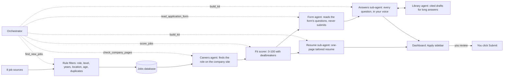

# Cassandra, your automated talent agent

<p align="center">
  
  <br>
  <sub>Cartoon &copy; Randy Glasbergen, <a href="https://www.glasbergen.com">glasbergen.com</a>.</sub>
</p>

<p align="center"><i>Cassandra won't pad your resume with Twitter followers. She checks every claim in code.</i></p>


In the myth, Cassandra could see the future and nobody believed her. This Cassandra sees
which jobs fit you, and you can believe her, because every claim she makes is backed by a
quote that code has checked.

Cassandra is a multi-agent job search assistant built on the Anthropic Claude API. She
finds AI and agent engineering roles (US-remote or in North Carolina's Research Triangle),
scores each one against a private candidate profile, rewrites a one-page Word resume
around each posting's exact keywords, and drafts an answer to every application question
in the candidate's own voice. Then she stops and hands the application over, because the
candidate always clicks Submit.

## Cassandra by the Numbers

| Outcome | Result |
| --- | --- |
| Applications sent with Cassandra | **28 jobs at 26 companies** |
| Time saved per application | **~30 minutes** (tailored resume plus every answer) |
| Total time saved on applications | **~14 hours** across 28 applications |
| Time saved on searching | **1+ hour every day**, because the morning run finds, filters, and scores new roles |
| Job sources searched | **8** boards, feeds, and lists |
| AI agents and sub-agents | **7**, each checked in code |
| Automated tests | **534**, run in CI on every push |
| Lines of Python and JavaScript | **~15,000**, plus ~10,000 lines of tests |

The application count comes from the jobs marked applied in the local database. The time
savings are the candidate's own measurements.

## How Cassandra Works



1. **Find.** Every morning she reads 8 sources and drops anything that is not an AI or
   agent engineering role, needs 3+ years, is in the wrong place, is stale, or is a
   duplicate. At most three roles per company make the cut.
2. **Verify.** For jobs found on third-party boards, the careers agent finds the same role
   on the company's own site, so the Apply button goes to the real posting.
3. **Score.** Claude scores each job from 0 to 100 against the profile, lists dealbreakers,
   and recommends apply or skip. Only jobs scoring 70 or more move on.
4. **Prepare.** For each good match, a board filler (or the form agent, for unfamiliar
   sites) opens the application in a headless browser and records every question without
   submitting. Then the resume and answers sub-agents build the apply kit. For long
   questions such as "why this company", the answers sub-agent asks the library agent for
   a draft that quotes the candidate's own writing.
5. **Hand over.** The dashboard shows each job with its score and a link to the role. Its
   Apply sidebar has every answer with a Copy button and the tailored resume to download.

## The Technical Bits, Explained

### AI development: seven agents that each do one job

| Agent | Model | What it does | How it is kept honest |
| --- | --- | --- | --- |
| **Orchestrator** | Sonnet 5.5 | Given a goal ("5 strong kits"), picks each next step: find jobs, check company pages, score, read a form, or build a kit. | Filters and budgets live in code. It has no submit tool. Every step, its time, and its token use go to a run log. |
| **Fit scorer** | Sonnet 5.5 | Scores a job 0 to 100 with reasons, dealbreakers, and a recommendation. | Structured outputs, then Pydantic validation of the score range. |
| **Careers agent** | Sonnet 5.5 | Finds a third-party job on the company's own site, using the web search tool. | The job title must appear on a page the agent actually opened. |
| **Form agent** | Opus 5.5 | Fills unfamiliar forms (Workday, iCIMS, Zoho, custom sites), across iframes and multiple pages. | Code refuses any click that would submit. Every question it sees is recorded. |
| **Library agent** | Sonnet 5.5 | Drafts written answers from a private folder of essays and write-ups. | Every sentence carries a quote, and code checks each quote. |
| **Resume sub-agent** | Opus 5.5 | Rebuilds a one-page Word resume around the posting's exact keywords. | Every bullet quotes its source. Code rejects any tool or number the sources don't support. |
| **Answers sub-agent** | Sonnet 5.5 | Answers every application question, plus "why this company" and "tell us about a project". | Factual answers must be exact phrases from the profile. Written answers match the candidate's writing samples. |

All of them use the Claude API's tool use loop. Where the API offers it, a refused request
is retried on a fallback model, so one refusal does not stop a run.

### Architecture design: deterministic where possible, agentic where it pays

- **Hard rules in code, judgment in the model.** Title, seniority, years of experience,
  location, posting age, and duplicates are decided by plain Python. A rule-based
  seniority classifier reads titles ("Engineer II", "new grad", "Staff") and required
  years. Only jobs that pass these rules are sent to the model, which keeps cost down and
  results predictable.
- **An orchestrator over existing modules.** The fixed pipeline still works. The agent
  mode (`job-run --agent --goal N`) wraps the same modules as tools, remembers which jobs
  were applied to or removed, and stops when the goal is met or a budget runs out.
- **Human in the loop by design.** Every run is a dry run unless stated otherwise.
  Hand-off mode fills a form in a kept Chrome window, and assist mode gives copyable
  answers. Live mode is opt-in, with fit re-checks, daily and per-company caps, and
  fail-closed handling of unconfirmed submissions.
- **Storage that can grow.** SQLAlchemy 2 models on SQLite by default, or PostgreSQL 16
  through Docker Compose, with 8 Alembic migrations.
- **A scheduler that runs itself.** `job-daily --install` registers a morning run with
  Windows Task Scheduler (or cron), timed so kits are ready by 9am Eastern.

### Machine learning and evaluation: measuring the model instead of trusting it

- **Grounded generation.** The resume and written answers work like retrieval with
  citations: the model may only use what it can quote from the master CV, the experience
  bank, the writing samples, or the candidate's public GitHub repositories. Code checks
  every quote against the source text.
- **Tuned per task.** Each agent gets the model that suits it: Opus 5.5 for the form
  agent and resume rewriting, where mistakes are costly; Sonnet 5.5 for scoring,
  answers, search, and orchestration, where speed and cost matter more. The fit
  threshold, kit limits, and per-company caps are all tunable in `config/settings.yaml`.
- **Multi-class classification with an LLM, plus rule-based post-processing.** Fit
  scoring sorts each job into one of three classes (apply, skip, or manual review) and
  gives it a 0-100 score with reasons and dealbreakers, as a structured output. Code then
  validates the score range and applies the rules: a dealbreaker found in code means
  skip, a dealbreaker the model found means manual review, and a score under 70 means
  skip.
- **Cost and speed tracking.** Each orchestrator run logs every step with its duration and
  its input, output, and prompt-cache token counts, so cost per kit can be measured.
- **Offline evaluation.** 534 pytest tests run with the Anthropic SDK and every HTTP call
  mocked. The form tests drive a real headless Chromium against local HTML forms,
  including multi-page forms and iframes.

### The creative bits (what sets Cassandra apart)

- **The qualification map.** For each posting, every required qualification, preferred
  qualification, and duty is copied word for word (checked against the posting), with the
  resume bullet that covers it and the quote that bullet came from. Gaps get a suggested
  bullet instead of a made-up one.
- **"LangGraph or LangChain" counts once.** The resume agent recognizes either-or
  requirements, so finding one of the two satisfies the line.
- **She looks in your GitHub before giving up.** Before calling a skill missing, the
  resume agent reads the candidate's public repositories (READMEs and dependency files)
  through the GitHub API, and a repository can become a project on the resume.
- **One page, measured.** The resume is a real Word file (python-docx) that copies the
  font, size, and section order of the candidate's own resume. Its height is measured
  with LibreOffice when it is installed, or with a cautious text-height estimate when it
  is not. The lowest-value bullets are trimmed until it fits, and a resume that leaves
  more than a tenth of the page empty is sent back once for more.
- **A form reader in JavaScript.** The form agent injects a snapshot script into each page
  and its iframes to list every control and its nearest label, so it can read custom
  forms whose questions are not linked to their fields.
- **Browser lock detection.** Before opening Chrome, Cassandra checks whether the agent's
  browser profile is already in use (the Windows lock file, or the SingletonLock link on
  macOS and Linux) and asks the candidate to close the old window.
- **A privacy guard that knows your secrets without storing them.** A custom pre-commit
  hook reads the candidate's values from the git-ignored profile at commit time and blocks
  any line that contains one, reporting only the category it found.

## Debugging Stories

**The blank browser window.** Pressing **Fill with agent** opened a Chrome window showing
only `about:blank`, and the console closed before anyone could read the error. I solved it
in four rounds, one cause at a time ([spec](specs/005-fill-with-agent-blank-window.md)):

1. **Make the failure visible.** Errors now stay on screen, and the window says which page
   it is opening right away.
2. **One browser per profile.** Chrome allows one browser per profile, so a second launch
   handed its blank tab to the open window and quit. Cassandra now detects the lock first,
   and the test uses full Chromium, the same browser the hand-off uses.
3. **The window hid behind the dashboard.** Windows won't let a background program bring
   its window to the front, so the agent minimizes and restores its window and moves it
   onto the main screen.
4. **The form wouldn't scroll.** Playwright draws pages at a fixed 1280x720, which cut off
   the bottom of the form in a smaller window. Opening the browser with `no_viewport=True`
   lets the page fit the window.

The lesson: when a failure leaves no trace, make it leave one first, then fix one cause at
a time and test each fix in the real environment.

**More bugs caught along the way:**

- **The careers agent made things up.** It once reported a role from a search result it
  never opened, and once reported a list of openings as the role. Code now requires the
  title on a page the agent opened, and follows a list to the role's own page.
- **One job in three failed to score.** Worker threads were sharing a database session.
  Reading job fields before the threads start fixed it.
- **The scorer rejected remote jobs.** It never saw the board's "USA - Remote" label.
  Giving the model every field the source has fixed it.
- **Questions went missing.** Questions on later pages, inside iframes, or past a control
  limit were never recorded. The agent now records every question it sees, and it is sent
  back if it tries to finish while a Next button remains.
- **No new jobs were showing up.** The local copy was 57 commits behind `main`. Running the
  current filters over all 195 saved jobs proved the code worked and the install was stale.

## What I Learned

- **Agent design:** when a fixed pipeline is enough, when a model should pick the next
  step, and how to keep the rules, the budgets, and the final submit in code.
- **The Anthropic Claude API:** tool use loops, structured outputs, the server-side web
  search tool, refusal fallbacks, token accounting, and matching Sonnet or Opus to a task.
- **Grounding and verification:** making a model cite its sources and checking those
  citations in code, so it cannot invent facts on a resume.
- **Browser automation with Playwright:** iframes, multi-page forms, browser profiles and
  their locks, viewports, and window focus on Windows.
- **Data and backend:** SQLAlchemy 2, Alembic migrations, SQLite and PostgreSQL, and thread
  safety with database sessions.
- **Testing and CI:** offline tests with mocked APIs, headless browser tests, and GitHub
  Actions.
- **Building with an AI coding agent:** working with Claude Code through specs, small pull
  requests, code review, a roadmap, and a written review checklist.
- **Privacy engineering:** keeping personal data out of a public repository with
  git-ignored paths and a pre-commit hook.

## Tech Stack

| Area | Technology |
| --- | --- |
| Language | Python 3.11+ (developed on 3.12), JavaScript for the in-page form snapshot |
| LLM | Anthropic Claude API: Sonnet 5.5 for scoring, answers, the careers agent, and the orchestrator; Opus 5.5 for the form agent and the resume sub-agent. Uses tool use, structured outputs, web search, and refusal fallback |
| Browser automation | Playwright (Chromium and installed Chrome) |
| Data | SQLAlchemy 2 with SQLite (default) or PostgreSQL 16; Alembic migrations; Pydantic v2 |
| HTTP and documents | httpx, pypdf, python-docx (tailored resumes), PyYAML, python-dotenv |
| Web UI | Standard-library `http.server`, HTML, CSS, JavaScript |
| Quality | pytest (offline: mocked HTTP and SDK, real headless browser), Ruff, GitHub Actions CI |
| Infrastructure | Docker Compose (optional Postgres), Git pre-commit hook, Windows Task Scheduler or cron for the morning run |
| Job sources | Greenhouse, Lever, Ashby, and SmartRecruiters board APIs; We Work Remotely RSS; Hacker News "Who is hiring?"; Himalayas API; SimplifyJobs new-grad list; GitHub REST API for skill evidence |
| Development tools | Claude Code (AI coding agent for specs, pull requests, and fixes), Git and GitHub pull requests, Notion for task tracking, PowerShell on Windows |

Dependency ranges are in [pyproject.toml](pyproject.toml). The tested versions are anthropic 0.125, playwright 1.63, SQLAlchemy 2.1, alembic 1.20, pydantic 2.13, httpx 0.28, pytest 8.4, and ruff 0.16.

## Quick Start

```powershell
py -3.12 -m venv .venv312; .\.venv312\Scripts\Activate.ps1
python -m pip install -e ".[dev]"
python -m playwright install chromium
copy .env.example .env               # add ANTHROPIC_API_KEY and RESUME_PATH
python scripts/install_hooks.py      # privacy guard
job-run                              # discover, score, prepare, open the dashboard
job-run --agent --goal 5             # let the agent pick each step until 5 kits are ready
job-daily --install                  # prepare new jobs every morning before 9am Eastern
```

`job-daily --install` registers a morning run with Windows Task Scheduler (or cron on macOS and Linux). It finds and scores new jobs, then builds a tailored resume and every answer for each good match, so they are waiting in the dashboard by `daily_run.ready_by` in [config/settings.yaml](config/settings.yaml). The log is in `data/daily-run.log`.

`job-run --agent --goal N` hands the run to one orchestrator agent. It sees the current counts, what you applied to and removed, and its last few runs, then picks its own next step (score, find new jobs, read a form, build a kit) until N kits are ready with no problems. The filters, the candidate list, and every budget stay in code, and it has no way to submit. Each run's steps, times, and token use are appended to `data/agent-runs.jsonl` (git-ignored). See [specs/009-orchestrator-agent.md](specs/009-orchestrator-agent.md).

Put your private profile in `profile/profile.yaml` (see the fictional [profile.example.yaml](profile/profile.example.yaml)). Put your master CV (every job, project, and activity) at `profile/master_cv.pdf`, or set `MASTER_CV_PATH` in `.env`; the resume at `RESUME_PATH` is the format example, or set `RESUME_FORMAT_PATH`. Put your long list of jobs, projects, and activities (any Markdown, text, PDF, or Word files) in `profile/library/`, and samples of your own writing in `profile/writing_samples/`. All three are git-ignored and blocked by the privacy hook. The scope, models, and caps are set in [config/settings.yaml](config/settings.yaml).

| Command | What it does |
| --- | --- |
| `job-run` | Full pipeline: discovery, fit scoring, company page lookup, answer preparation, dashboard; `--agent --goal N` lets the orchestrator agent pick the steps |
| `job-agent` | Discovery only |
| `job-apply` | Fill a Greenhouse, Lever, Ashby, or SmartRecruiters form (dry run; `--hand-off`, `--assist`, `--live`) |
| `job-agent-fill` | Run the form agent on any other application form |
| `job-company-pages` | Find third-party jobs on the company's own site |
| `job-daily` | Morning run: find, score, and build kits for new good matches; `--install` schedules it every morning (Task Scheduler or cron), `--uninstall` stops it |
| `job-kit` | Build one job's kit: tailored resume and every answer (`--list` for job ids, `--question` for one-off answers) |
| `job-dashboard` | Serve the dashboard at `http://127.0.0.1:8765/` |

Run `pytest` and `ruff check .` to test and lint. The tests make no network or API calls.

For Claude Code, [.claude/skills/](.claude/skills/) has three skills (`apply-kit`, `tailor-resume`, `answer-questions`) that run these commands directly instead of re-deriving the workflow.

## Safety Rules

- **Nothing is submitted without the candidate,** except with `--live`, and only when every safeguard passes.
- **No accounts, passwords, or CAPTCHAs.** The agents hand these to the person at the browser.
- **No guessed facts or qualifications.** Unanswerable fields are left blank and listed for review.
- **No LinkedIn scraping, and robots.txt is respected.** Sites that block automated access are not used.

## Repository Map

```text
agent/
  main.py, pipeline.py      discovery and the job-run pipeline
  orchestrator.py           job-run --agent: picks each next step toward a goal of N kits
  filters.py, seniority.py  deterministic scope and duplicate rules
  scorer.py, answers.py     Claude fit scoring and grounded answers
  careers_agent.py          finds the role on the company's own site
  form_agent.py (+ .js)     agent for unfamiliar forms
  library_agent.py          cited drafts from the private source library
  apply_kit.py              job-kit: runs the resume and answers sub-agents for one job
  resume_tailor.py          resume sub-agent: exact-keyword resume, every bullet sourced
  resume_format.py          master CV and format example: what the resume picks from, how it looks
  github_evidence.py        skill evidence from the candidate's public GitHub repositories
  answer_agent.py           answers sub-agent: every question for one job
  dashboard.py              local dashboard server
  fetchers/, sources/       job board APIs and remote sources
  applier/                  board form fillers, review pages, hand-off/assist/live CLI
db/                         SQLAlchemy models and Alembic migrations
scripts/                    privacy pre-commit hook
tests/                      offline test suite
```

## Roadmap

Discovery, fit scoring, board form fillers, live-mode safeguards, hand-off and assist
modes, the dashboard, the form agent, the source library, the careers agent, the apply
kit, the qualification map, the orchestrator agent, and the morning run are all built.
What comes next is in [ROADMAP.md](ROADMAP.md).
